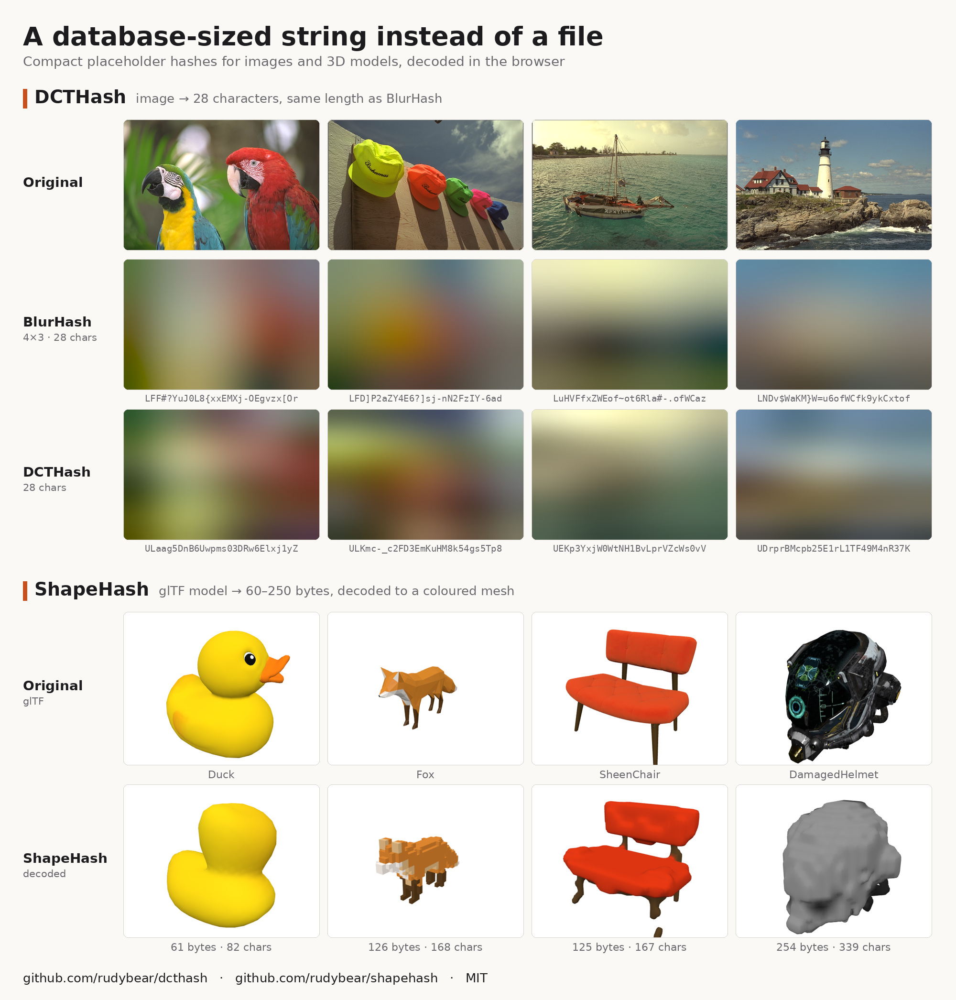
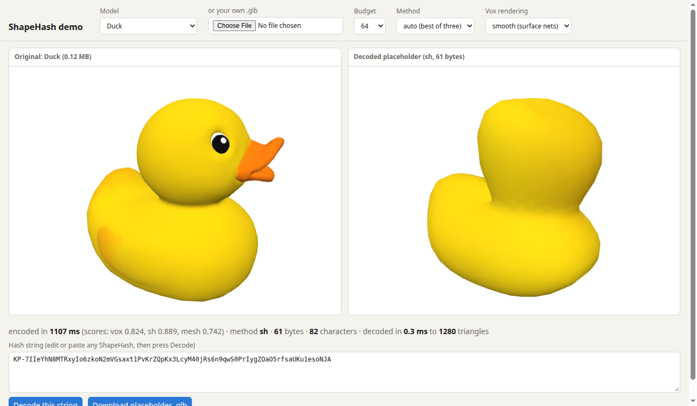
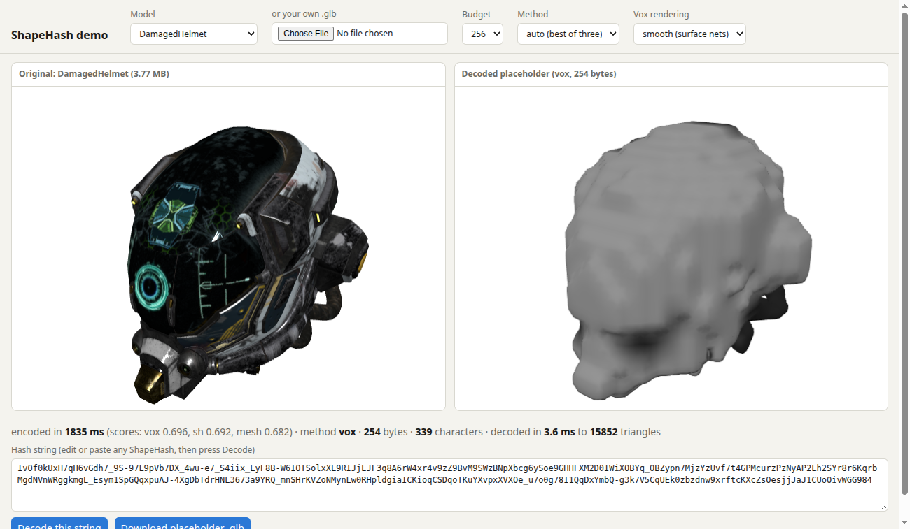
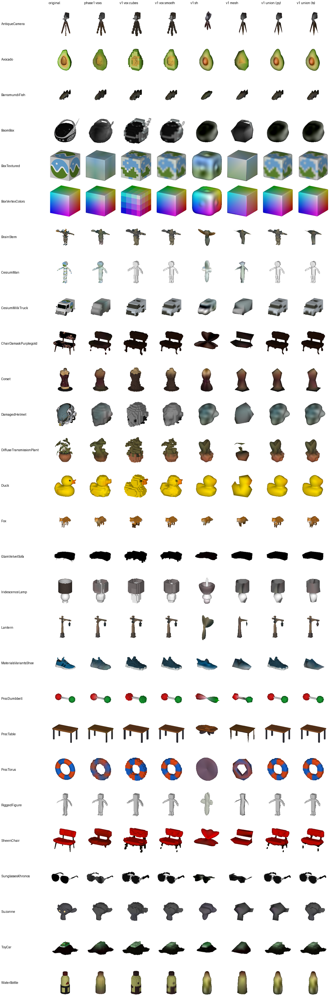
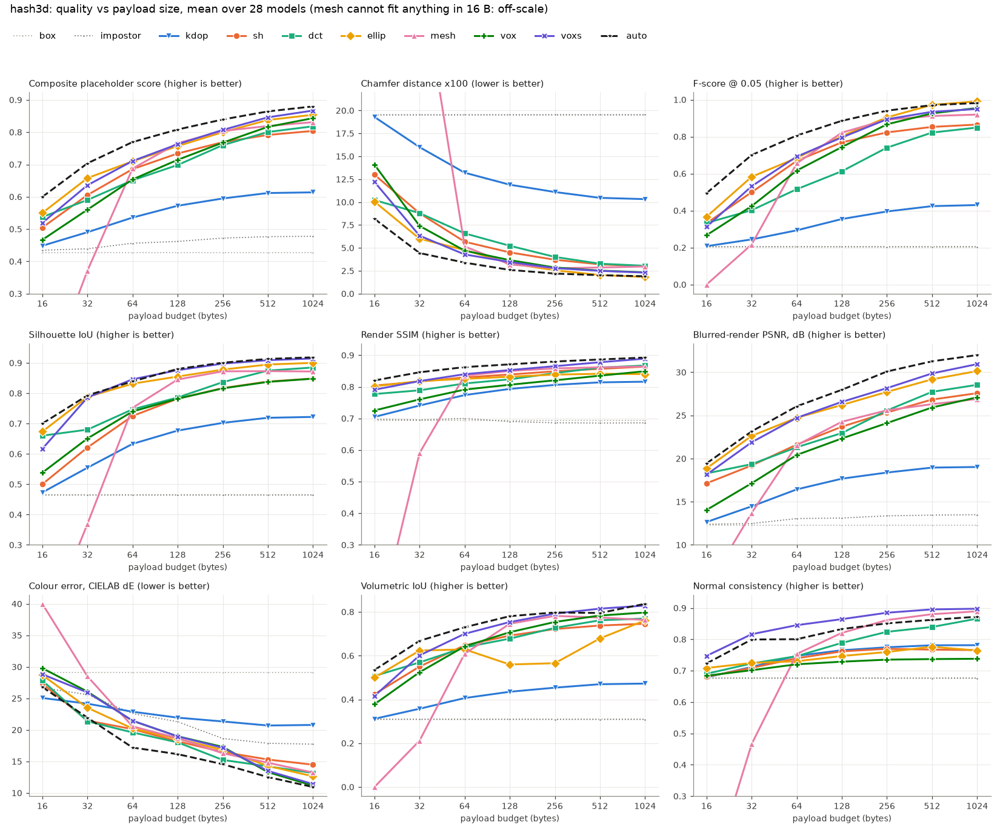
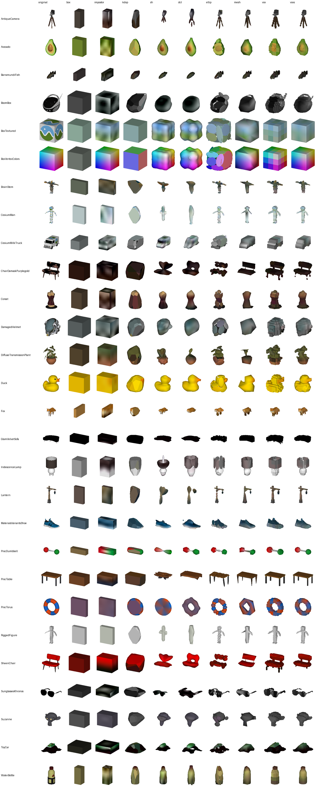

# ShapeHash — a BlurHash-style placeholder string for 3D assets

[BlurHash](https://github.com/woltapp/blurhash) turns an image into a ~25
character string that decodes to a blurry placeholder. ShapeHash does the same for 3D: a short URL/JSON/DB-safe string that decodes to a
crude coloured mesh, shown while the real glTF loads.

```
Duck, 61 bytes:  KP-7IIeYhN8MTRxyIo6zkoN2mVGsaxt1PvKrZQpKx3LcyM40jRs6n9qwS0PrIygZOaO5rfsaUKu1esoNJA
```



*ShapeHash next to its 2D sibling, [DCTHash](https://github.com/rudybear/dcthash), which does
the same for images at BlurHash's string length.*



*The demo page: original GLB on the left, the placeholder decoded from the string on the right.
Duck, 61 bytes (82 characters), spherical-harmonics method.*



*DamagedHelmet (3.77 MB) at 254 bytes, voxel method with the smooth decoder. Shape survives;
texture detail does not.*

All 28 test models at 128 bytes: the original, then each method, with the shipped union in the
last two columns:



This repository has two parts:

1. **ShapeHash v1** (this section): a frozen format ([SPEC.md](SPEC.md)), a
   TypeScript library with decoder, encoder, GLB export, CLI and demo page
   (`ts/`), and a Python reference implementation (`hash3d/v1/`) that the
   TypeScript one is cross-validated against.
2. **Phase 1 exploration** (second half of this file): the comparison of nine
   candidate representations that led to the format.

## Format in one paragraph

A hash is base64url (no padding) of a payload whose first byte carries a
version and a method tag, followed by the bounding-box aspect ratio. The
encoder tries three representations and keeps the best one for the byte
budget; the decoder dispatches on the tag.

| method | what is stored | decoder | good at |
|---|---|---|---|
| `vox` | occupancy grid up to 64^3, compressed with a context-adaptive binary range coder; one colour per block of voxels, either RGB444 or an index into a 1–32 colour palette (range coded) | cube faces, or surface nets on a blurred 2x grid | everything; the default winner |
| `sh` | spherical-harmonic series for radius (outermost surface around a centre) and for colour | evaluate on an icosphere | blobs at small budgets |
| `mesh` | up to 1023 vertices with 5–8 bit positions and RGB444 colours, connectivity as generalised triangle strips | read the tables | 128 bytes and up; cheapest to draw |

The decoded mesh is in a normalised frame (bounding box centred, longest
half-extent 1); absolute position and scale are not stored. Any budget from
about 16 to 2048 bytes is legal. **Recommended: 128 bytes (171 characters);
64 bytes (86 characters) when space is tight; 256 for hero assets.** Full
definition, integer tables and decoder limits are in [SPEC.md](SPEC.md).

## TypeScript library (`ts/`)

Node 22 was used; the library targets ES2020 and has no runtime dependencies
in the decoder, encoder or GLB writer. `pngjs` and `jpeg-js` are used only by
the Node glTF loader.

```
cd ts
npm install
npm run build        # tsc declarations + esbuild bundles into dist/, demo bundle into demo/dist/
npm test             # build + node:test suites (decode vectors, malformed input, encoder, GLB validation)
npm run typecheck    # src + tests + demo
node bench.mjs       # decode timings over the test vectors
```

Decode (browser or Node, ESM):

```ts
import { decode } from "shapehash/decode";       // 12.4 kB minified, 5.5 kB gzip
const mesh = decode(hash, { vox: "smooth" });     // or "cubes"; throws ShapeHashError on bad input
// mesh.positions: Float32Array (xyz), mesh.indices: Uint32Array, mesh.colors: Uint8Array (sRGB, 3 per vertex),
// mesh.normals: Float32Array, mesh.method: "vox" | "sh" | "mesh", mesh.flat, mesh.extents
```

Encode from geometry and colours:

```ts
import { encode, exportGLB } from "shapehash";
const r = encode({ positions, indices, colors /* per vertex, or colorAt(tri, w0, w1, w2, out) for textures */ }, { budget: 128 });
// r.hash, r.method, r.bytes, r.scores, r.candidates, r.center, r.scale  (p_normalised = (p - center) * scale)
const glb = exportGLB(decode(r.hash));            // Uint8Array
```

Encode from a GLB (textures, materials, node transforms):

```ts
import { loadGltfFile } from "shapehash/node";    // Node: PNG/JPEG via pngjs / jpeg-js
import { loadGltf } from "shapehash/gltf";        // any platform: pass your own decodeImage
const r = encode(await loadGltfFile("model.glb"), { budget: 128 });
```

CLI:

```
node dist/cli.js encode ../data/models/Duck.glb --budget 128 [--method auto|vox|sh|mesh] [--json]
node dist/cli.js decode <hash> out.glb [--cubes]
node dist/cli.js info <hash>
node dist/cli.js batch out.json --budgets 64,128,256 a.glb b.glb ...
```

### Demo page

```
cd ts
npm install && npm run build
node demo/serve.mjs            # prints http://127.0.0.1:8377/  (optional port argument)
```

Open the printed URL. The page shows the original GLB next to the decoded
placeholder with one shared orbit camera, the hash string, a budget selector
(32–512), a method selector, and the vox rendering mode. Editing or pasting a
string and pressing "Decode this string" shows any hash; `?hash=<string>` in
the URL does the same; "Download placeholder .glb" exports it. Models are
listed from `../data/models` and `../data/procedural` (run
`scripts/download_models.py` first); a file picker accepts any `.glb`.
Encoding runs in the browser (about 1–2 s on the main thread). three.js is
bundled into `demo/dist/main.js`, so the page works offline. The server only
serves `ts/demo/` and `data/` and binds to 127.0.0.1.

`node demo/smoke.mjs` drives the page in headless Chrome through the DevTools
protocol and saves screenshots to `results/v1/demo/`.

### What the encoder does

All three encoders work from one dense coloured point sample of the surface
(600 000 points), so they need no ray tracer or external mesh library and are
the same algorithms in TypeScript and Python:

- **vox**: for each candidate grid size, build a solid occupancy grid (flood
  fill from outside, thin sheets boosted), range-code it, then try every
  colour mode and cell size that fits. Keep the candidate with the best
  `F-score of the cube decode + colour term`. This replaces the phase-1
  heuristic that starved colour.
- **sh**: bin the samples into a 6x32x32 cube map around the solid's centroid,
  take the outermost radius and its colour per bin, fit by weighted ridge
  least squares.
- **mesh**: surface nets on the blurred solid grid, vertex clustering to a
  32^3 lattice, heap-driven quadric collapses with a normal-flip guard, then
  for each position precision 5–8 bits the largest vertex count that fits;
  keep the best-scoring one.
- **selection**: decode all candidates and keep the highest mean of
  F-score@0.05, colour term (CIELAB) and a 3-view 24x24 silhouette IoU.

The Python encoder (`hash3d/v1/encode.py`) is a slow reference (10–20 s per
model and budget); the TypeScript encoder takes about 1 s.

## Verification

Everything below was run on this machine (Linux, Node 22.23, Python 3.12).

| check | result |
|---|---|
| `npm test` | 18 tests pass |
| TS decode vs Python decode, 110 Python-encoded vectors (vox in all 7 colour modes, sh, mesh; vox in both renderings) | integer content identical; positions, normals, indices and colours **bit-identical** for all three methods |
| Python decode of 252 strings from the TS encoder (28 models x 3 budgets x 3 methods, 504 decodes) | all decode, all within budget, all bit-identical to the TS decode (`scripts/crosscheck_ts.py`) |
| Malformed input, TS: wrong types, bad characters/lengths, wrong version/method/reserved bits, 405 truncations, 600 mutations, 600 random strings, a 64^3 random grid | only `ShapeHashError` or a bounded, valid mesh; worst case about 250 ms |
| Malformed input, Python: 586 mutated / truncated / random strings | only `FormatError` or a valid mesh |
| Exported GLBs through the Khronos `gltf-validator` | 16 in the test suite + 20 example/CLI files (TS and Python exporters): 0 errors, 0 warnings |
| Demo page in headless Chrome (software GL) | 4 models load, encode and decode in the browser; paste-a-hash and bad-hash paths work |

sh output depends on `sin`/`cos`/`atan2`, which are not guaranteed identical
across platforms, so the spec gives it a tolerance (1e-5 positions, 1/255
colours). On this machine the two implementations agree exactly; other
JS engines or CPUs were not tested.

Not verified: browsers other than headless Chrome, mobile devices, a visual
check in a third-party glTF viewer (the validator and three.js's loader were
used instead), and Draco/KTX2/WebP assets (the loader rejects or ignores
them).

## Results for v1

Same 28 models, harness and metrics as phase 1 (composite = mean of
F-score@0.05, silhouette IoU, render SSIM and a colour term). Full tables:
[results/v1/summary.md](results/v1/summary.md); sheets:
`results/v1/sheets/v1_budget_{064,128,256}.png`; example GLBs and strings:
`results/v1/examples/`.

| | 64 B | 128 B | 256 B |
|---|---|---|---|
| phase 1, best single method (`voxs`) | 0.711 | 0.763 | 0.807 |
| phase 1, oracle best of 9 methods | 0.769 | 0.808 | 0.839 |
| v1 `vox` alone, smooth decode | 0.764 | 0.811 | 0.848 |
| v1 `vox` alone, cube decode | 0.714 | 0.770 | 0.818 |
| v1 `sh` alone | 0.692 | 0.730 | 0.765 |
| v1 `mesh` alone | 0.693 | 0.781 | 0.824 |
| **v1 union, Python encoder** | 0.777 | 0.823 | 0.853 |
| **v1 union, TypeScript encoder** | 0.776 | 0.823 | 0.853 |

Other metrics for the TypeScript-encoded union (phase-1 `voxs` in brackets):
Chamfer x100 3.65 / 2.75 / 2.49 (4.29 / 3.46 / 2.79); colour dE 14.7 / 13.4 /
11.4 (21.5 / 19.0 / 17.2); silhouette IoU 0.852 / 0.877 / 0.894 (0.846 /
0.876 / 0.898).

Method kept by the TypeScript encoder, of 28 models: 64 B vox 21, sh 7,
mesh 0; 128 B vox 15, sh 7, mesh 6; 256 B vox 20, sh 1, mesh 7. The
point-based selection score lands within 0.002 of an oracle that picks by the
full composite.

What changed since phase 1, and what it bought (all 28 models):

- **vox colour**: palette modes plus a searched geometry/colour split. Colour
  dE at 64 / 128 / 256 B went from 21.5 / 19.0 / 17.2 to 14.6 / 12.9 / 10.7,
  and the composite by +0.04 to +0.05. The smooth decoder also changed (surface
  nets on an integer blur instead of marching cubes on a Gaussian blur), so
  this is not a single-variable comparison.
- **mesh plateau**: selectable 5–8 bit positions, surface-nets remesh and a
  guarded heap simplifier. Chamfer x100 at 256 / 512 B went from 2.78 / 2.86
  to 2.26 / 2.10; the composite at 512 B from 0.819 to 0.845.
- **sh**: unchanged in quality (0.692 / 0.730 / 0.765 vs 0.686 / 0.734 /
  0.769) but no longer needs a ray tracer.

Tuning and held-out data: models were split alternately into a tuning half
and a held-out half (14 each). The one thing chosen by looking at scores was
the form of the selection score (adding the silhouette term, dropping normal
consistency), on the tuning half only. The vox search itself has no tuned
constants beyond its candidate lists. On the held-out half the v1 union
scores 0.799 / 0.842 / 0.863 at 64 / 128 / 256 B against 0.716 / 0.767 /
0.814 for phase-1 `voxs`, so the gains are not an artefact of tuning. The
thin-sheet threshold and occupancy contexts were carried over from phase 1,
where they had been set on all 28 models.

Decoder cost (TypeScript, Node 22, median over the test vectors):

| | 64 B | 128 B | 256 B |
|---|---|---|---|
| mesh | 0.008 ms, 22 tris | 0.009 ms, 44 tris | 0.007 ms, 95 tris |
| sh | 0.18 ms, 1280 tris | 1.2 ms, 5120 tris | 2.4 ms, 5120 tris |
| vox, cubes | 0.13 ms, 992 tris | 0.29 ms, 2008 tris | 0.99 ms, 4720 tris |
| vox, smooth | 0.75 ms, 3784 tris | 2.1 ms, 7732 tris | 5.3 ms, 18644 tris |

Bundle sizes: decoder only 12.4 kB minified (5.5 kB gzip); decoder + encoder +
GLB writer 41.9 kB (17.8 kB gzip). Encoder time in Node: about 0.9–1.1 s per
budget (max 1.7 s) plus about 0.15 s once per model for loading and sampling.

## Honest limits

- **The union buys less than expected.** Once vox colour was fixed, vox alone
  is within 0.005–0.013 of the union (0.764 vs 0.777 at 64 B, 0.848 vs 0.853
  at 256 B). `sh` is kept for 7 of 28 models at 64–128 B and 1 at 256 B. If
  decoder size matters more than the last percent, a vox-only or vox+mesh
  profile is defensible; the format allows it (unknown methods are simply
  never emitted).
- **Smooth vox meshes are heavy.** 128-byte vox hashes decode to about
  10 000 triangles on average with the surface-nets renderer (up to 17 000
  seen; about 2 600 with cubes). There is
  no level-of-detail control yet; a 1x renderer would quarter that but loses
  one-voxel rods.
- **Thin rods can break.** A one-voxel-thick leg survives the blur as a sheet
  but isolated voxels do not, so chair legs can show gaps (see
  `results/v1/demo/sheenchair_128.png`). The cube renderer does not have this
  problem.
- **Colour is still coarse**: mean dE is 11–15. Textures with fine detail
  become region means; `mesh` and `sh` colour is weaker than `vox` (dE 16–20).
- **No absolute transform, no animation, no PBR.** Only base colour is used.
  The TypeScript glTF loader follows the spec (linear factors and vertex
  colours, sRGB textures); the Python harness multiplies everything in sRGB
  (`--raw-colors` in the CLI reproduces that and was used for the
  cross-evaluation so both encoders saw the same colours).
- **glTF loader scope**: triangles only, `TEXCOORD` selected by the base
  colour texture, PNG/JPEG, no Draco, meshopt, KTX2, texture transforms,
  skinning (bind pose) or sparse accessors.
- **Encoder is not streaming or worker-based**; in the browser it blocks the
  main thread for 1–2 s. It is deterministic for a given input, but the Python
  and TypeScript encoders use different random samples and do not produce the
  same strings (their quality is the same).
- **Test set**: 28 models, mostly single props from one repository.
- The composite score and the "recognisable at 64 bytes" judgement are mine,
  not a user study.

## Format decisions worth revisiting before calling it 1.0

- The name.
- base64url (6 bits/char) versus a denser alphabet such as base85/base91
  (about 6–8 % shorter, less universally safe).
- 3 version bits (8 versions) and 2 method bits (one method slot left).
- vox grid cap of 64 per axis and colour cells up to 16 voxels.
- RGB444 colours in `mesh` and in direct-mode `vox`; a shared palette for
  `mesh` would be the next colour improvement.
- Whether `sh` stays in the profile (see limits).
- The default triangle cap (500 000) and the smooth renderer being a
  reference algorithm rather than a normative one.

## Layout

```
SPEC.md                  format definition
ts/                      TypeScript library
  src/format.ts          constants, base64url, bit I/O, range coder, SH basis, icosphere
  src/decode.ts          parse + decode (the dependency-free decoder entry point)
  src/glb.ts             GLB writer
  src/encode/            source.ts (sampling, occupancy, scoring), vox.ts, sh.ts, mesh.ts, index.ts
  src/adapters/          gltf.ts (GLB/glTF -> encoder input), node.ts (files, PNG/JPEG)
  src/cli.ts             command line
  test/                  decode vectors, malformed input, encoder, GLB validation; vectors/vectors.json
  demo/                  index.html, main.ts, serve.mjs, smoke.mjs
  bench.mjs, build.mjs
hash3d/v1/               Python reference: format.py, decode.py, encode.py
hash3d/codecs/v1.py      adapters into the evaluation harness
scripts/make_vectors.py  Python -> ts/test/vectors/vectors.json
scripts/crosscheck_ts.py Python check of TypeScript-encoded strings
scripts/report_v1.py     results/v1/summary.md and sheets
results/v1/              summary.md, sheets/, examples/, demo/ screenshots, ts_encoded.json, raw/
results/v1ts/            evaluation of the TypeScript-encoded strings
```

Reproduce the v1 numbers (after the phase-1 setup below):

```
HASH3D_RESULTS=$PWD/results/v1 .venv/bin/python -I scripts/run_eval.py --budgets 32 64 128 256 512 --methods vox1 vox1c sh1 mesh1 union1
.venv/bin/python -I scripts/make_vectors.py
(cd ts && npm install && npm test && node bench.mjs \
   && node dist/cli.js batch ../results/v1/ts_encoded.json --budgets 64,128,256 --raw-colors ../data/models/*.glb ../data/procedural/*.glb ../data/models/Suzanne/Suzanne.gltf)
.venv/bin/python -I scripts/crosscheck_ts.py
HASH3D_RESULTS=$PWD/results/v1ts .venv/bin/python -I scripts/run_eval.py --budgets 64 128 256 --methods ts1
.venv/bin/python -I scripts/report_v1.py
```

---

# Phase 1: exploration of candidate representations

This is the original experiment that compared nine representations at equal
payload size and led to the choice of vox + sh + mesh. Its codecs (in
`hash3d/codecs/`, exploratory payload formats, not ShapeHash v1) and results
(`results/`) are kept as they were; method names below refer to those codecs.

[BlurHash](https://github.com/woltapp/blurhash) turns an image into a ~25 character
string that decodes to a blurry placeholder. This experiment asks what the 3D
analog looks like: a short, DB-column-friendly string that decodes to a crude
coloured mesh shown while the real glTF loads.

Phase 1 contains seven candidate representations plus two baselines behind one codec
interface, a GLB exporter, and an evaluation harness that compares them at
equal *serialized* payload size on 28 models.

**Short answer.** An arithmetic-coded occupancy grid with coarse colour cells
(`vox` / `voxs`) is the most robust single representation from 32 to 1024
bytes. Spherical harmonics (`sh`) are better on blob-like objects at 32–128
bytes, a strip-coded decimated mesh (`mesh`) is competitive from about 128
bytes and has the cheapest decoder, and a set of coloured ellipsoids (`ellip`)
scores best on point-distance metrics but looks scaly. Because every payload
starts with a method tag, picking the best method per model costs no extra
bytes and beats every single method at every budget. Placeholders become
recognizable for most models at about 64 bytes (86 characters); 128–256 bytes
is the comfortable range. Details, numbers and caveats are below.



## Layout

```
hash3d/              library
  asset.py           GLB/glTF -> normalised asset, colour lookup, surface sampling, solid voxelisation
  bitio.py           bit writer/reader, base64url armour, shared quantisers
  mesh.py            decoded ColorMesh, GLB exporter, icosphere / Fibonacci tables
  render.py          orthographic ray-cast renderer (embree) for metrics and sheets
  metrics.py         geometry / colour / render metrics
  codecs/            base.py (interface + registry), simple.py (box, impostor), kdop.py,
                     sh.py, dct.py, ellip.py, meshc.py, vox.py (vox + voxs)
scripts/
  download_models.py     fetch Khronos sample assets into data/models/
  make_procedural.py     three procedural models (torus, table, dumbbell)
  run_eval.py            every codec x every model x every budget -> results/raw, results/thumbs
  report.py              tables, plots, example GLBs
  make_sheets.py         visual comparison sheets
  hash3d_cli.py          encode a GLB to a hash / decode a hash to a GLB
  smoke.py, preview_originals.py   quick checks
data/models/         downloaded assets (untrusted data; no code lives here)
data/procedural/     generated assets
results/             summary.md, results.csv, plots/, sheets/, examples/, raw/
```

## Reproduce

```
uv venv .venv && uv pip install -p .venv/bin/python -r requirements.txt   # or python -m venv + pip
.venv/bin/python -I scripts/download_models.py
.venv/bin/python -I scripts/make_procedural.py
.venv/bin/python -I scripts/run_eval.py --budgets 16 32 64 128 256 512 1024 --jobs 28   # phase-1 codecs only by default
.venv/bin/python -I scripts/report.py
.venv/bin/python -I scripts/make_sheets.py

# one-off use of a phase-1 codec
.venv/bin/python -I scripts/hash3d_cli.py encode data/models/Duck.glb --budget 64 --method voxs --legacy
.venv/bin/python -I scripts/hash3d_cli.py decode <hash> out.glb --legacy
```

`-I` keeps Python from importing anything from the working directory or the
data directory. The whole evaluation (28 models x 9 codecs x 7 budgets, 1764
encode/decode/evaluate round trips) takes about 95 seconds on a 32-core
machine. Python 3.12; pinned versions are in `requirements.txt`.

## Ground rules of the comparison

- **Interface.** `codec.encode(asset, budget_bytes) -> str` and
  `decode_any(str) -> ColorMesh` (vertices, triangles, per-vertex sRGB colour).
  `export_glb` writes the result as a GLB (`POSITION`, `COLOR_0` converted to
  linear as glTF requires, `NORMAL` for smooth methods, a double-sided
  material).
- **Fairness.** The budget is the size of the binary payload in bytes,
  *including* a one-byte header (4-bit method tag + 4-bit method parameter).
  The runner asserts `payload <= budget`, and every metric is computed on a
  mesh decoded from the string alone. There are no side channels: grid sizes,
  coefficient counts and counts of primitives are either in the payload or
  derived from a table baked into the codec.
- **String.** URL-safe base64 without padding, 6 bits per character
  (32 B -> 43 chars, 64 -> 86, 128 -> 171, 256 -> 342, 512 -> 683). BlurHash's
  base83 would give 6.37 bits per character, about 6 % fewer characters; not
  implemented.
- **Frame.** Assets are normalised so the bounding box is centred at the
  origin with the longest half-extent equal to 1. The hash stores the box
  aspect ratio (3 x 6 bits) but not absolute position or scale: the host
  application is assumed to know the node transform / bounds of the asset.
- **Colour ground truth.** Base-colour texture x base-colour factor, vertex
  colours, or the material colour, sampled per surface point. Everything is
  handled in sRGB. Metallic/roughness, emission, transmission, texture
  transforms and alpha are ignored, so the "original" renders are albedo with
  a headlight, not PBR.
- **Solid occupancy.** Most sample assets are not watertight, so "inside" is
  defined by flood fill: surface points are splatted into a grid, the surface
  is dilated by one voxel, everything not reachable from the border is inside.
  Open shells stay thin shells; gaps narrower than about two voxels get sealed.
  The same definition is used by the encoders and by the volumetric IoU
  metric.

## Candidate representations

| candidate | status | verdict before measuring |
|---|---|---|
| Spherical harmonics of radius + colour | implemented (`sh`) | very compact; only star-shaped objects |
| Low-frequency 3D DCT of an SDF + colour, marching cubes | implemented (`dct`) | the literal BlurHash analog; any topology; thin parts vanish; heavy decoder |
| K coloured ellipsoids / Gaussians | implemented (`ellip`) | good for limbs and multi-part objects; lumpy |
| Decimated mesh, quantised, compact connectivity | implemented (`mesh`) | connectivity + per-vertex cost is high; trivial decoder |
| Convex hull / k-DOP | implemented (`kdop`) | cheap, robust, convex only |
| Coarse occupancy grid + colours | implemented (`vox` blocky, `voxs` smoothed) | any topology; blocky unless smoothed |
| Bounding box + six tiny face image hashes | implemented (`impostor`) | good colour, no shape |
| Bounding box + mean colour | implemented (`box`) | 6-byte floor for reference |
| Superquadrics | not implemented | same payload shape as ellipsoids plus 2 exponents per primitive; needs a nonlinear fit on the encode side. Would help boxy parts. Reasoned only. |
| Hybrid: SH base + a few ellipsoids | not implemented as one payload | the per-model `auto` selector covers the "use SH when it works, something else otherwise" case; a true residual hybrid is reasoned only |
| Fixed-topology template mesh shrink-wrapped to the surface | not implemented | spatial-domain cousin of `sh` with no connectivity cost; same star-shape-like limits unless the wrap is non-radial |
| Three silhouettes -> visual hull | not implemented | n^3 shape from 3n^2 bits, but cannot represent concavities and the arithmetic-coded grid already costs about as little |
| Alpha-masked cross billboards | not implemented | needs alpha-tested textures rather than vertex colours; breaks the "geometry + colours" decode contract |

### Payload formats

All payloads start with `tag:4 | param:4`. "extents" is the bbox half-extent
triple at 6 bits each. Colours are RGB444 unless noted. YCoCg is used where
colour is transform-coded. "coeff block" means a 6-bit log-scale shared
maximum followed by sign-sqrt-companded values with an odd number of levels
(the BlurHash AC trick).

- **`box`** (tag 0), 6 bytes regardless of budget: extents 18, RGB555 15.
- **`impostor`** (tag 1): param = class index into a baked table of (luma,
  chroma) DCT sizes per face. extents 18; per face: luma DC 6 + coeff block at
  4 bits, Co and Cg DC 5 + coeff block at 3 bits. Encoder ray-casts a 32x32
  orthographic colour image per box face, fills background from the nearest
  foreground pixel, takes the lowest n x n DCT terms. Decoder: box with each
  face a vertex-coloured grid.
- **`kdop`** (tag 7): K' 8, extents 18, 6 x RGB444 for the axis planes, then
  K' x (support distance 6 bits + RGB444). Directions are a baked Fibonacci
  sphere. Each plane's colour is the mean colour of the surface samples
  closest to that plane. Decoder: half-space intersection, one flat polygon
  per plane.
- **`sh`** (tag 2): param = class index into a baked table of degrees
  (L radius, Ly luma, Lc chroma), e.g. 32 B -> (3, 3, 1), 64 B -> (6, 4, 2),
  128 B -> (10, 6, 4), 256 B -> (15, 9, 6), 512 B -> (21, 15, 8). extents 18,
  centre 3 x 5, radius DC 7 + coeff block at 5 bits, luma DC 6 + block at 4
  bits, Co/Cg DC 5 + block at 3 bits. The expansion is done in box-normalised
  coordinates (bbox stretched to a cube) around the centroid of the solid;
  radius is the distance to the *outermost* surface along each direction
  (ray-cast from outside), colour is the colour there. Fit is ridge least
  squares with a Laplacian prior on 6000 directions. Decoder: evaluate on an
  icosphere (1280 triangles up to L = 8, 5120 above).
- **`dct`** (tag 3): param = class index into a baked table of coefficient
  counts (SDF, luma, chroma) with a 58 / 22 / 2 x 10 % bit split. extents 18,
  iso level 4, SDF DC 7 + coeff block at 4 bits, luma DC 6 + block at 4 bits,
  Co/Cg DC 5 + block at 3 bits. Field is `tanh(sdf / 5 voxels)` on a 64^3 grid
  over the bbox enlarged by 15 %; coefficients are kept in order of
  a^2 + b^2 + c^2. Colour is a separate cosine series fitted by least squares
  on surface samples (plus copies jittered along the normal so the field is
  stable off the surface). The encoder decodes its own quantised field and
  picks the iso level that best matches the occupancy. Decoder: inverse DCT on
  a 32^3 grid, marching cubes, colour series evaluated at the vertices.
- **`ellip`** (tag 6): K 7, then K x 59 bits: centre 3 x 6, log-radii 3 x 5,
  rotation as smallest-three quaternion 2 + 3 x 4, RGB444. 32 B -> 4
  ellipsoids, 64 -> 8, 128 -> 17, 256 -> 34, 512 -> 69. Encoder: hard-EM
  Gaussian mixture, tried in two modes (blobs filling the solid volume, or
  flat "surfels" tiling the surface) at several radius scales; the candidate
  with the best chamfer / silhouette-IoU^2 after an actual decode is kept.
  Decoder: one low-poly sphere per ellipsoid, triangles fully buried in another
  ellipsoid dropped.
- **`mesh`** (tag 8): extents 18, vertex count 8, triangle count 10, then per
  vertex (in order of first use) position 3 x 6 + RGB444, then the strip code:
  per triangle `continue:1` (omitted for the first), `edge:1` if continuing,
  and per vertex reference `new:1` or `0` + index in ceil(log2(seen)) bits.
  Encoder: solid occupancy 64^3 -> marching cubes (a clean closed surface even
  for multi-part soups) -> `fast-simplification` to 600 faces -> own greedy
  quadric-error collapses down to whatever fits (binary search on vertex
  count). Measured cost is about 43 bits per vertex all-in, of which
  connectivity is roughly 6–7 bits per triangle. Result: 4 vertices at 32 B,
  12 at 64, 24 at 128, 47 at 256, 93 at 512.
- **`vox` / `voxs`** (tags 4 / 5, identical layout): extents 18, grid dims
  3 x 6, colour-cell factor f 5, occupancy byte count 10, one RGB444 per
  *active* colour cell (cells of f^3 voxels that contain surface voxels; the
  decoder derives which are active from the occupancy), then the
  occupancy bitmap coded with an LZMA-style binary range coder using 16
  contexts (3 face + 3 edge causal neighbours) with baked priors. The grid is
  anisotropic (near-cubic voxels inside the bbox). The encoder searches grid
  resolutions and keeps the best trade-off between geometry and colour
  resolution; trailing range-coder bytes are stripped while a trial decode
  still reproduces the grid. Thin sheets are boosted during downsampling so
  shells do not disappear. Measured median grid size on the long axis: 4 voxels at
  16 B, 9 at 32 B, 14 at 64 B, 26 at 128 B, 36 at 256 B, 48 (the cap) at
  512 B, with colour cells typically 4–5 voxels wide. The geometry/colour
  trade-off is a fixed heuristic (maximise grid size / f^(1/3)) that leans
  heavily towards geometry and was not tuned. `vox` decodes to exposed
  cube faces; `voxs` upsamples, blurs and runs marching cubes.

### Decoder complexity (what would have to run in JS / on a phone)

| method | decoder needs | cost | mean triangles at 128 B |
|---|---|---|---|
| box | nothing | trivial | 12 |
| mesh | bit reader -> vertex and index buffers | trivial | 43 |
| ellip | K instanced spheres with an affine transform (or splats / SDF union in a shader) | low | 5255 (unculled low-poly spheres; instancing makes this moot) |
| vox | binary range decoder (about 40 lines) + emit cube faces | low | 3277 |
| sh | SH basis evaluation on a fixed icosphere; the basis matrix can be precomputed per degree | low | 5120 |
| impostor | 2D inverse DCT per face (or six tiny textures on a cube) | low | 768 |
| kdop | half-space intersection = 3D convex hull of K dual points | medium | 171 |
| voxs | range decoder + blur + **marching cubes** | high | 6158 |
| dct | 3D inverse DCT on 32^3 + **marching cubes** (or ray-march the series in a fragment shader) | high | 6813 |

No method needs an optimizer on the decode side. Optimizers, EM, ray casting
and trial decodes are all on the encode side. Python decode times in the
tables are for this reference code and are not representative (the SH basis
is rebuilt from scratch on every decode, for example).

Encode time, mean per model, single thread: under 0.15 s for `box`, `impostor`,
`kdop`; under 0.4 s for `voxs`; `mesh` 0.5 s for the first budget (it builds the
whole collapse sequence once) and under 0.15 s after; 0.3–0.7 s for `vox`; up
to 1 s for `sh`; 0.2–3.5 s for `dct`; `ellip` is
the slowest at 0.6 s (32 B) to 6.7 s (512 B) and 10.8 s (1024 B), worst case
18 s. Nothing takes minutes. `auto` costs the sum of all encoders plus a full
evaluation per candidate.

## Metrics

Computed in the normalised frame on 30 000 surface samples per side (the
evaluation samples use a different seed from every encoder's samples):

- **Chamfer** (mean of both directions, L1, x100 in the tables; 1.0 = 0.5 % of
  the longest side), **F-score** at 0.05 (2.5 % of the longest side),
  **normal consistency** (|n . n'| at nearest neighbours), **volumetric IoU**
  of solid occupancy on a 64^3 grid.
- **Colour dE**: CIELAB (CIE76) difference at nearest-surface correspondences,
  both directions.
- **Render metrics**: six fixed orthographic views at 160 px, albedo x
  headlight shading on white: silhouette IoU, PSNR, SSIM, and PSNR after a
  Gaussian blur (sigma 3 px) of both images.
- **Composite score** (used for ranking and for `auto`): mean of F-score,
  silhouette IoU, SSIM and `1 - min(dE, 40) / 40`. This is an ad-hoc scalar; it
  is not validated against human judgement. All raw metrics are in
  `results/results.csv` and `results/summary.md`.

## Data

25 models from KhronosGroup/glTF-Sample-Assets plus 3 procedural ones:

- blobs: Duck, Avocado, BarramundiFish, Suzanne
- hard-surface props: DamagedHelmet, BoomBox, WaterBottle, Corset, AntiqueCamera, Lantern, MaterialsVariantsShoe
- characters with limbs: Fox, BrainStem, CesiumMan, RiggedFigure
- vehicles / multi-part: CesiumMilkTruck, ToyCar
- furniture with thin legs: SheenChair, GlamVelvetSofa, ChairDamaskPurplegold
- thin / awkward: SunglassesKhronos, IridescenceLamp, DiffuseTransmissionPlant
- colour-path tests: BoxVertexColors, BoxTextured
- procedural: ProcTorus (genus 1, striped), ProcTable (thin legs), ProcDumbbell (two spheres on a rod)

Four names from the brief (Buggy, 2CylinderEngine, ReciprocatingSaw,
GearboxAssy) no longer have a `glTF-Binary` variant in the repository (404) and
were dropped. Skinned models are used in bind pose. `results/originals.png`
shows all originals as rendered by the harness.

## Results

Means over the 28 models. Full per-budget tables with every metric, per-model
scores and timing are in [`results/summary.md`](results/summary.md).

**Composite score (higher is better)**

| method | 16 B | 32 B | 64 B | 128 B | 256 B | 512 B | 1024 B |
|---|---|---|---|---|---|---|---|
| box | 0.428 | 0.428 | 0.428 | 0.428 | 0.428 | 0.428 | 0.428 |
| impostor | 0.434 | 0.439 | 0.456 | 0.462 | 0.472 | 0.477 | 0.478 |
| kdop | 0.448 | 0.490 | 0.536 | 0.572 | 0.595 | 0.612 | 0.614 |
| sh | 0.505 | 0.605 | 0.686 | 0.734 | 0.769 | 0.791 | 0.804 |
| dct | 0.537 | 0.590 | 0.651 | 0.698 | 0.760 | 0.801 | 0.818 |
| ellip | **0.550** | **0.658** | 0.710 | 0.757 | 0.800 | 0.838 | 0.854 |
| mesh | 0.000 | 0.371 | 0.687 | **0.766** | 0.804 | 0.819 | 0.831 |
| vox | 0.467 | 0.560 | 0.654 | 0.714 | 0.768 | 0.816 | 0.843 |
| voxs | 0.519 | 0.636 | **0.711** | 0.763 | **0.807** | **0.846** | **0.867** |
| auto (best per model) | 0.600 | 0.704 | 0.769 | 0.808 | 0.839 | 0.864 | 0.880 |

**Chamfer distance x100 (lower is better)**

| method | 16 B | 32 B | 64 B | 128 B | 256 B | 512 B | 1024 B |
|---|---|---|---|---|---|---|---|
| box | 19.51 | 19.51 | 19.51 | 19.51 | 19.51 | 19.51 | 19.51 |
| kdop | 19.30 | 16.00 | 13.21 | 11.90 | 11.10 | 10.47 | 10.33 |
| sh | 12.99 | 8.78 | 5.67 | 4.51 | 3.71 | 3.20 | 3.01 |
| dct | 10.22 | 8.80 | 6.59 | 5.23 | 4.01 | 3.28 | 3.05 |
| ellip | 10.06 | 6.00 | 4.77 | 3.32 | 2.56 | 2.04 | 1.83 |
| mesh | empty | 35.79 | 5.16 | 3.19 | 2.78 | 2.86 | 2.97 |
| vox | 14.08 | 7.40 | 4.70 | 3.67 | 2.86 | 2.52 | 2.33 |
| voxs | 12.21 | 6.33 | 4.29 | 3.46 | 2.79 | 2.49 | 2.30 |
| auto | 8.18 | 4.44 | 3.39 | 2.60 | 2.20 | 2.02 | 1.90 |

**F-score @ 0.05**

| method | 16 B | 32 B | 64 B | 128 B | 256 B | 512 B | 1024 B |
|---|---|---|---|---|---|---|---|
| box | 0.205 | 0.205 | 0.205 | 0.205 | 0.205 | 0.205 | 0.205 |
| kdop | 0.207 | 0.244 | 0.293 | 0.354 | 0.395 | 0.424 | 0.430 |
| sh | 0.332 | 0.499 | 0.669 | 0.769 | 0.823 | 0.853 | 0.865 |
| dct | 0.333 | 0.402 | 0.516 | 0.613 | 0.740 | 0.822 | 0.849 |
| ellip | 0.367 | 0.583 | 0.685 | 0.803 | 0.904 | 0.972 | 0.991 |
| mesh | 0.000 | 0.217 | 0.656 | 0.822 | 0.892 | 0.912 | 0.919 |
| vox | 0.267 | 0.424 | 0.617 | 0.744 | 0.867 | 0.926 | 0.955 |
| voxs | 0.312 | 0.532 | 0.692 | 0.796 | 0.894 | 0.934 | 0.949 |
| auto | 0.494 | 0.701 | 0.806 | 0.886 | 0.941 | 0.970 | 0.982 |

**Silhouette IoU over six views**

| method | 16 B | 32 B | 64 B | 128 B | 256 B | 512 B | 1024 B |
|---|---|---|---|---|---|---|---|
| box / impostor | 0.465 | 0.465 | 0.465 | 0.465 | 0.465 | 0.465 | 0.465 |
| kdop | 0.473 | 0.555 | 0.633 | 0.677 | 0.702 | 0.719 | 0.722 |
| sh | 0.500 | 0.621 | 0.725 | 0.782 | 0.817 | 0.839 | 0.849 |
| dct | 0.660 | 0.680 | 0.747 | 0.786 | 0.837 | 0.875 | 0.885 |
| ellip | 0.674 | 0.788 | 0.832 | 0.855 | 0.878 | 0.895 | 0.900 |
| mesh | 0.000 | 0.369 | 0.752 | 0.845 | 0.872 | 0.873 | 0.872 |
| vox | 0.538 | 0.651 | 0.740 | 0.782 | 0.816 | 0.837 | 0.848 |
| voxs | 0.617 | 0.786 | 0.846 | 0.876 | 0.898 | 0.909 | 0.915 |
| auto | 0.700 | 0.793 | 0.839 | 0.880 | 0.901 | 0.913 | 0.918 |

**Render SSIM**

| method | 16 B | 32 B | 64 B | 128 B | 256 B | 512 B | 1024 B |
|---|---|---|---|---|---|---|---|
| box | 0.693 | 0.693 | 0.693 | 0.693 | 0.693 | 0.693 | 0.693 |
| impostor | 0.698 | 0.695 | 0.700 | 0.690 | 0.686 | 0.685 | 0.686 |
| kdop | 0.705 | 0.741 | 0.774 | 0.793 | 0.806 | 0.814 | 0.816 |
| sh | 0.804 | 0.816 | 0.830 | 0.839 | 0.849 | 0.857 | 0.864 |
| dct | 0.777 | 0.789 | 0.811 | 0.824 | 0.843 | 0.861 | 0.867 |
| ellip | 0.802 | 0.818 | 0.825 | 0.832 | 0.839 | 0.841 | 0.840 |
| mesh | 0.000 | 0.591 | 0.836 | 0.850 | 0.858 | 0.862 | 0.864 |
| vox | 0.725 | 0.760 | 0.791 | 0.807 | 0.821 | 0.835 | 0.849 |
| voxs | 0.791 | 0.818 | 0.840 | 0.853 | 0.865 | 0.878 | 0.889 |
| auto | 0.820 | 0.846 | 0.862 | 0.871 | 0.880 | 0.886 | 0.893 |

**Colour error, CIELAB dE (lower is better)**

| method | 16 B | 32 B | 64 B | 128 B | 256 B | 512 B | 1024 B |
|---|---|---|---|---|---|---|---|
| box | 29.1 | 29.1 | 29.1 | 29.1 | 29.1 | 29.1 | 29.1 |
| impostor | 26.7 | 25.6 | 22.6 | 21.3 | 18.6 | 17.9 | 17.7 |
| kdop | 25.1 | 24.2 | 22.9 | 21.9 | 21.3 | 20.7 | 20.8 |
| sh | 27.3 | 21.5 | 20.1 | 18.2 | 16.5 | 15.3 | 14.5 |
| dct | 27.8 | 21.4 | 19.6 | 18.0 | 15.2 | 14.2 | 13.2 |
| ellip | 28.7 | 23.5 | 20.2 | 18.6 | 16.8 | 14.3 | 12.6 |
| mesh | empty | 28.5 | 20.6 | 18.7 | 16.3 | 14.8 | 13.2 |
| vox | 29.8 | 26.1 | 21.4 | 19.0 | 17.3 | 13.3 | 11.2 |
| voxs | 28.8 | 25.9 | 21.5 | 19.0 | 17.2 | 13.5 | 11.4 |
| auto | 26.8 | 21.9 | 17.2 | 16.2 | 14.6 | 12.5 | 10.9 |

**Which method wins per model under the composite score** (count of the 28 models)

| budget | box | impostor | kdop | sh | dct | ellip | mesh | vox | voxs |
|---|---|---|---|---|---|---|---|---|---|
| 16 | 0 | 1 | 2 | 3 | 7 | 10 | 0 | 1 | 4 |
| 32 | 0 | 1 | 1 | 7 | 2 | 13 | 0 | 0 | 4 |
| 64 | 0 | 2 | 0 | 10 | 0 | 12 | 1 | 0 | 3 |
| 128 | 0 | 2 | 0 | 8 | 0 | 8 | 5 | 0 | 5 |
| 256 | 0 | 2 | 0 | 7 | 1 | 8 | 3 | 0 | 7 |
| 512 | 0 | 2 | 0 | 4 | 1 | 7 | 1 | 1 | 12 |
| 1024 | 0 | 0 | 0 | 4 | 0 | 6 | 1 | 2 | 15 |

Bytes actually used are within a few bytes of the budget for most methods up
to 512 B. Exceptions: `box` is always 6 B; `impostor` steps through a coarse
class table (86 of 128 B, 673 of 1024 B); `vox`/`voxs` leave about 5–8 %
unused at 256–512 B and stop at a 48-voxel grid (861 of 1024 B); `ellip` caps
at 127 ellipsoids (939 B) and `kdop` at 255 directions (587 B). The 1024 B
column therefore understates those methods slightly.

### Visual comparison

`results/sheets/budget_XXX_view0.png` and `..._view1.png` show every model
(rows) against the original and every method (columns) at one budget;
`results/sheets/model_<Name>.png` shows one model across budgets. Example, 128
bytes:



`results/plots/score_spread.png` shows the per-model spread of the composite
score for each method and budget.

### Example hashes

`results/examples/` holds decoded GLBs for Duck, Fox, SheenChair,
DamagedHelmet, Lantern and CesiumMilkTruck, with the strings in
[`results/examples/HASHES.md`](results/examples/HASHES.md). Two of them:

- Duck, 15 bytes, `voxs`: `UP-7AggRgN-A_3Og_uUo`
- Duck, 59 bytes, `sh`: `Jf-7IIe2r1M_WnifzOye3iZUctrG3XC8rNk-krHat7IzjSNHTqR2rBLRNskKBo5o6mt-NpQarU-yg0k`

## Findings

1. **No single representation dominates; a tagged union does.** `auto` beats
   the best single method by 0.01–0.06 composite at every budget (0.769 vs
   0.711 at 64 B; 0.808 vs 0.766 at 128 B). Put differently, `auto` at 64 B
   scores about what the best single method needs 128 B for. The winners split
   by shape class: `sh` on blobs and convex-ish props (Duck, Avocado, Suzanne,
   BoomBox, DamagedHelmet, WaterBottle, shoe), `ellip` on limbs and multi-part
   objects (characters, AntiqueCamera, sunglasses, dumbbell, ToyCar), `voxs`
   on furniture and at high budgets, `mesh` in between.
2. **The occupancy grid is the robust default.** `voxs` is first or within
   0.025 of first on the composite at every budget from 32 B up, has the best
   silhouette IoU, SSIM and normal consistency almost everywhere, and has no
   catastrophic failures on this set. `vox` is the same payload with a trivial
   decoder; it loses about 0.02–0.08 composite to blockiness (normal
   consistency 0.70–0.74 vs 0.82–0.90, silhouette IoU about 0.07–0.14 lower)
   but its Chamfer distance is nearly the same.
3. **The literal BlurHash analog (`dct`) is not the right 3D analog.** At
   equal bytes it is behind the arithmetic-coded grid on geometry at every
   budget from 32 B (F-score 0.516 vs 0.692 at 64 B, 0.740 vs 0.894 at 256 B),
   and it needs marching cubes just like `voxs`. A binary shape is described
   by its boundary; context-coded occupancy spends bits only there, while a
   cosine series spends them on a band-limited volume. `dct` does have
   slightly the best colour at 128–256 B and is best at 16 B on 7 models.
4. **Explicit meshes are useless below about 64 bytes and good from 128.**
   At 16 B nothing fits; at 32 B the result is a 4-vertex sliver and 7 of 28
   models encode to nothing; at 64 B (12 vertices) it is already level with
   `sh`; at 128–256 B it is the best or second-best single method, with the
   cheapest decoder and 43–90 triangles. It plateaus after 256 B (Chamfer 2.78
   -> 2.86 -> 2.97) because of this pipeline: 6-bit positions, a 64^3 remesh
   and a guard-free collapse sequence, not because of the representation.
5. **Ellipsoids win the point metrics and lose on looks.** `ellip` has the
   best Chamfer and F-score at 16–32 B and again from 256 B to 1024 B, and the
   best composite at 16–32 B. But its SSIM is flat (0.80–0.84), its normal
   consistency stays low (0.71–0.78), and its volumetric IoU dips at 128–256 B
   when the encoder switches to surfel mode and leaves gaps. On the sheets it
   reads as a pile of scales. It is also not monotonic: ProcTorus scores 0.817
   at 64 B and 0.634 at 256 B. With a splat or smooth-union shader instead of
   opaque low-poly spheres it would look better; that is reasoned, not tested.
6. **SH degrades gracefully on blobs and fails loudly otherwise.** Duck at
   64 B scores 0.900, against 0.80 for the next best method on that model. On
   ProcTable, ProcTorus, SheenChair and SunglassesKhronos it produces a
   lens-shaped or winged blob with no legs or hole (0.41–0.62 at 64 B).
7. **Convex hulls and box impostors are not worth their bytes.** `kdop`
   saturates around 0.61 composite; silhouette IoU never passes 0.72. The
   six-image box impostor barely moves from the 6-byte single-colour box
   (0.48 vs 0.43 at 512 B): better colour, identical shape error. It wins only
   on the two cube test models.
8. **Colour is the weaker half everywhere.** Mean dE stays above 11 even at
   1024 B, because most of these textures have high-frequency detail that no
   placeholder at this size can carry. All methods end up encoding roughly
   "mean colour per region"; differences between methods in dE are small
   compared with differences in geometry.

### How many bytes?

This is a judgement from looking at the sheets (32, 128 for all models; 64
and 256 for a subset), not a measured recognition rate:

- **16 B (22 chars):** bounding blob with the right colour. Not recognizable.
- **32 B (43 chars):** gist for simple shapes (duck, bottle, table, torus,
  dumbbell, chair read correctly in `voxs`/`ellip`); characters and thin
  objects do not.
- **64 B (86 chars):** first budget where most models are recognizable as
  their class in at least one method. This is the minimum I would ship.
- **128 B (171 chars):** comfortable. Limbs, legs and holes are present in
  `voxs`/`mesh`; silhouette IoU 0.85–0.88.
- **256 B (342 chars):** good placeholders; returns diminish after this
  (composite +0.04 from 128 to 256, +0.04 from 256 to 512, +0.02 to 1024).

### Recommendation

- **One representation only:** the occupancy grid. Ship the `vox` payload and
  choose the decoder per platform: cube faces where simplicity matters,
  marching cubes (`voxs`) where it is affordable. Budget 128 B, or 64 B if the
  column is tight.
- **Best quality per byte:** a tagged union of `voxs`, `sh` and `mesh` (add
  `ellip` if the scaly look is acceptable or a splat renderer is available),
  with the encoder trying each and keeping the best. That needs three small
  decoders instead of one.
- **Cheapest possible decoder:** `mesh` at 128 B or more.
- **By budget:** 32 B `ellip` or `voxs`; 64 B `voxs` (or `sh` for blobs);
  128–256 B `voxs` or `mesh`; 512 B and above `voxs`.

### Failure modes

| method | fails on | how |
|---|---|---|
| sh | anything not star-shaped: legs, holes, thin protrusions, multi-part | parts missing or smeared into wings; ringing at high degree |
| dct | thin parts and open shells | they vanish or become fat sheets (IridescenceLamp shade at 32–128 B); blobby at low budgets |
| ellip | smooth large surfaces; high budgets | lumpy or scaly surface, gaps in surfel mode, non-monotonic quality, slowest encoder |
| mesh | budgets under 64 B; thin shells | empty or sliver output; shells become double-walled; faceted colour |
| vox | smooth objects | staircase silhouette and normals; one colour per cell |
| voxs | very low resolution grids | melted look; legs fuse; decoder needs marching cubes |
| kdop | every concavity | shrink-wrapped hull |
| impostor / box | everything | it is a box |
| all | layered or transparent surfaces (sunglasses lenses, plant leaves) | colour is averaged over layers the viewer never sees |

## What was verified and what was not

Verified by running: all nine codecs round-trip through the actual string on
all 28 models at 7 budgets (1764 runs, no errors, payload size asserted);
metrics, tables, plots and sheets are generated from those runs; the CLI
encodes and decodes; exported GLBs load back in trimesh.

Not verified: the exported GLBs were not opened in a browser glTF viewer or
run through the Khronos validator. No JS decoder was written, so the decoder
complexity column is an estimate from the Python decoders. Recognizability
thresholds are my reading of the sheets, not a user study. Base83 packing,
superquadrics, residual hybrids, template wrapping, visual hulls, splat
rendering of ellipsoids and a real Edgebreaker-class connectivity coder
(which would roughly halve the connectivity cost of `mesh`, an estimate) are
reasoned only.

## Caveats

- 28 models, mostly single props from one sample repository; no scenes, no
  foliage-heavy or architectural assets. Mean scores are sensitive to the mix
  (seven of the 28 are thin or multi-part, two are cubes).
- A few parameters were tuned on this same set: the DCT coefficient bit depth
  (3/4/5/6 bits tried, 4 kept, differences of about 0.01 composite), the
  thin-sheet handling in `dct` and `vox`, and the ellipsoid selection proxy.
  There is no held-out set.
- The composite score is arbitrary. Under Chamfer or F-score alone `ellip`
  ranks first; under SSIM or normal consistency `voxs` and `mesh` do.
- "Original" renders are unlit albedo with a headlight; PBR appearance
  (metal, glass, emission) is not part of the ground truth. GlamVelvetSofa is
  nearly black under this model.
- The solid-occupancy definition seals gaps narrower than about 3 % of the
  longest side and treats open shells as thin walls. It is applied to
  both sides of the IoU metric, but it does shape what "inside" means.
- Encode times were measured with 28 worker processes on a 32-core machine.
